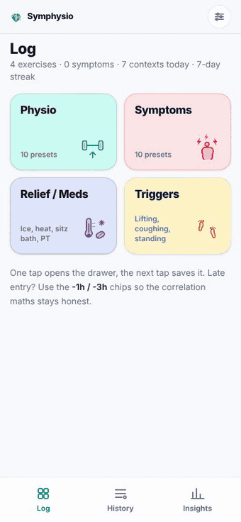
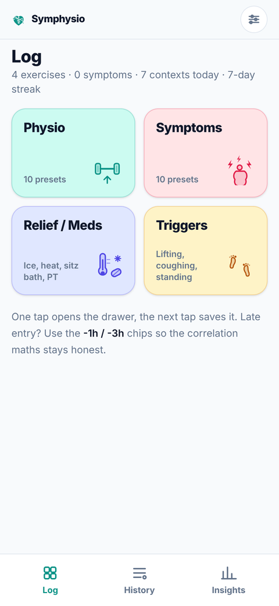
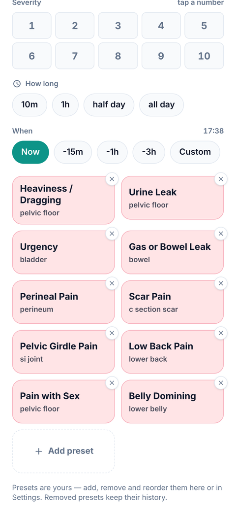
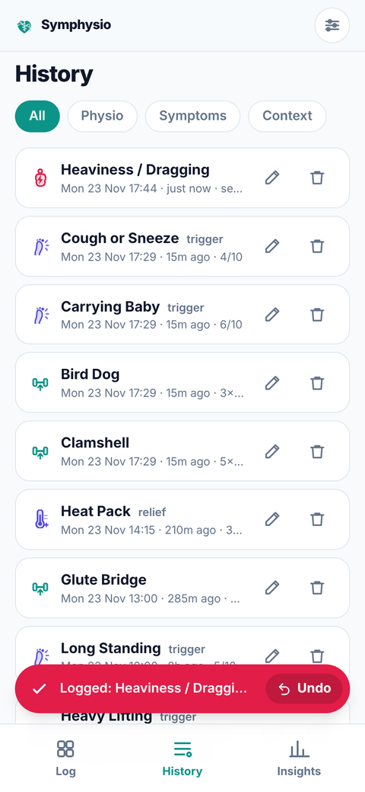
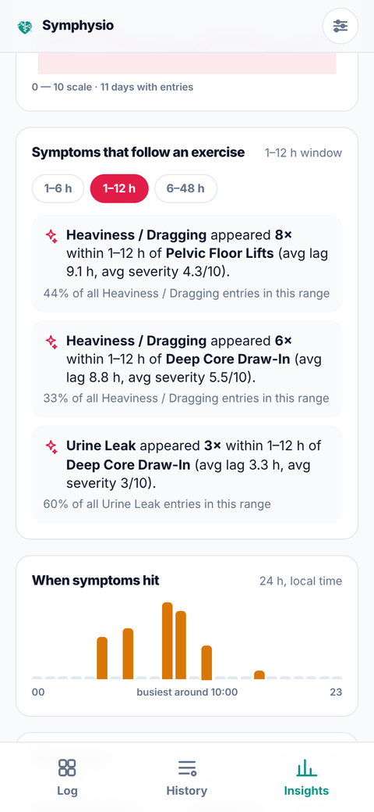
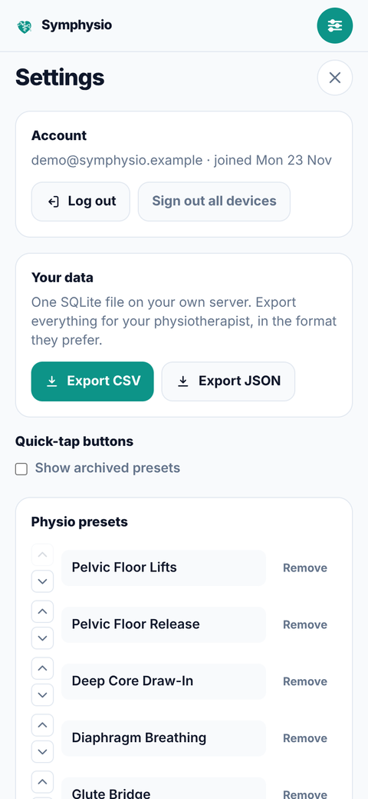
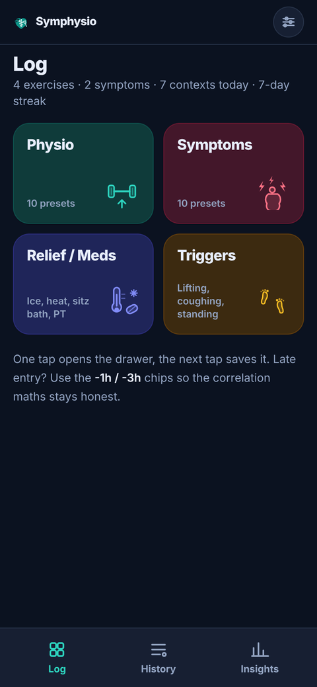

# Symphysio

[](https://github.com/alecc08/symphysio/actions/workflows/ci.yml)
[](https://github.com/alecc08/symphysio/actions/workflows/build.yml)
[](https://github.com/alecc08/symphysio/releases)
[](LICENSE)


[](https://github.com/alecc08/symphysio/pkgs/container/symphysio)

**Click and log.** A mobile-first PWA for tracking physiotherapy exercises and
physical symptoms in one or two taps — with an analytics-ready SQLite database
behind it, so you can finally answer *"does this exercise actually make the next
24 hours better or worse?"*



*Two taps: the Symptoms tile, a severity, the preset. The Undo toast is already
up before the row reaches History, and Insights is the reason to keep logging:
which exercise this symptom tends to follow, and how long after.*

- **Backend:** Python 3.12+, FastAPI, Pydantic v2, aiosqlite (raw parameterized SQL, no ORM), Argon2id, SQLite in WAL mode.
- **Frontend:** React 19 + TypeScript + Vite + Tailwind CSS 4, hand-drawn inline SVG icons, CSS-only animation, installable PWA (iOS/Android home screen, offline shell).
- **Deployment:** one container that serves both the JSON API and the compiled SPA.

## Why the "click and log" discipline

Pain tracking dies when logging takes effort, and lag analysis dies when the
timestamps are wrong. So every surface is one or two taps, every write is
immediately reversible with a 5-second Undo, and every quick-log drawer carries a
`Now / -15m / -1h / -3h / Custom` strip so a late entry still lands at the right
time. Nothing is ever soft-deleted silently; definitions are archived instead of
deleted so historical logs keep their meaning.

## Built for the postnatal window

The default catalogs assume the thing you are tracking is **pelvic floor recovery
after birth**: heaviness/dragging, urine leak, urgency, gas or bowel leak, perineal
or C-section scar pain, pelvic girdle pain, belly domining — alongside the physio
that rebuilds it (lifts *and* release, deep core, diaphragm breathing, gradual
loading) and the things that actually set symptoms off in that season of life
(heavy lifting, car-seat lifts, coughing, straining, carrying the baby, long
standing).

None of it is prescriptive and none of it is permanent:

- **Add your own** — type a name in the quick-log drawer or in Settings; the app
  makes a preset out of it immediately.
- **Remove what is irrelevant** — the ✕ on any preset archives it (Undo offered),
  and archived presets keep their history so your charts do not change retroactively.
- **Reorder** — the button you tap most should be first.
- **Suggestion pool** — ~45 more postnatal presets (bleeding, pressure/bulge,
  constipation, neck and wrist pain from feeding, return-to-exercise-too-soon…)
  are offered as one-tap adds and disappear once you have them.

## What it looks like

All of it from a seeded demo account — no real health data anywhere in this repo.

| The four tiles | A symptom: severity, then the preset |
| --- | --- |
|  |  |

| History, with Undo still up | The lag panel: what follows what |
| --- | --- |
|  |  |

| Settings: your presets and your data | Dark theme, same layout |
| --- | --- |
|  |  |

## Quick start (development)

```bash
# 1. API (http://127.0.0.1:8000)
cd backend
uv sync
uv run uvicorn app.main:app --reload

# 2. App (http://localhost:5173, proxies /api to :8000)
cd ../frontend
npm ci
npm run dev
```

For plain-HTTP local development the browser still accepts the session cookie on
`localhost`, but if you serve over a LAN IP set `SYPHYSIO_COOKIE_SECURE=0`.

Seed data: registration creates 10 exercise, 10 symptom and 16 relief/trigger
presets, all editable in the quick-log drawer and in **Settings → Quick-tap
buttons**. For three weeks of plausible history — the data in every screenshot
above — run `python3 scripts/demo_seed.py` against a throwaway instance.

## Run it for real (one container)

```bash
docker compose up -d --build          # serves on 127.0.0.1:8090
```

Or pull a published image instead of building — the package is public, so a
deploy host needs no credentials:

```bash
docker pull ghcr.io/alecc08/symphysio:latest   # or the exact version you want
```

Put a TLS reverse proxy in front of it (Caddy/Traefik/nginx) — `Secure` cookies
and the CSP assume HTTPS. The container runs as uid `10001` on a read-only root
filesystem; the only writable paths are `/data` (the SQLite file) and `/tmp`.
See [docs/DEPLOYING.md](docs/DEPLOYING.md) for the proxy snippet, environment
reference and backup cron.

## Versioning and releases

The version of record is [`VERSION`](VERSION) — one line, plain semver. Merging a
PR to `main` whose `VERSION` has no `v<VERSION>` tag yet publishes a GitHub
Release (notes come from that version's section of
[CHANGELOG.md](CHANGELOG.md)) and builds `ghcr.io/alecc08/symphysio:<version>`.
So the release *is* the merge: there is nothing to run by hand.

A feature PR bumps `VERSION` and adds its `CHANGELOG.md` section in the same
branch. Docs-only and test-only PRs do not bump. What the numbers mean, and what
to do about a tag that is already public, is in
[docs/RELEASES.md](docs/RELEASES.md).

```bash
curl -fsS https://<host>/api/v1/openapi.json | python3 -c 'import json,sys;print(json.load(sys.stdin)["info"]["version"])'
```

## Quality gates

```bash
cd backend  && uv run pytest && uv run ruff check app tests
cd backend  && uv export --frozen --no-emit-project --format requirements-txt \
              | uv run pip-audit --strict --requirement=/dev/stdin
cd frontend && npm run build && npm audit --audit-level=high
```

GitHub Actions runs all of the above on every push and pull request, plus:

- `uv lock --check` and `npm ci --dry-run`, so a lock file can never drift from
  its manifest (Dependabot PRs are checked by exactly these two);
- a container build and a hardened smoke test, which also asserts that the
  running app reports the version in `VERSION`;
- a secret scan of history (gitleaks) and a static audit of the workflows
  themselves (zizmor);
- a weekly re-run of both dependency audits, because CVEs appear after the code
  was written.

## What it does

| Area | Detail |
| --- | --- |
| **Log** | Four tiles (Physio, Symptoms, Relief/Meds, Triggers). Tap tile → tap preset → saved. Optional dose/effort/pain/severity/duration and retroactive time. |
| **History** | Unified chronological feed with filters, inline edit (severity, note, time) and delete with Undo. |
| **Insights** | Daily counts, severity trend, hour-of-day distribution, top presets, and exercise→symptom lag correlations over a configurable window. |
| **Settings** | Catalog manager (add / rename / reorder / remove / restore, plus a suggested-preset pool), CSV and JSON export, sign out one or all devices. |
| **Account** | Optional email confirmation (Resend, or nothing at all): a single-use 24 h link, a reminder banner, and a gate that is the admin's choice — `off`, `optional` (default) or `required`. Sign-up itself can be closed with `SYPHYSIO_ALLOW_REGISTRATION=0`. |
| **API** | `/api/v1` JSON only: auth, catalog, logs, timeline, analytics, export. Contract in [docs/API.md](docs/API.md). |

## Documentation

| File | Contents |
| --- | --- |
| [docs/ARCHITECTURE.md](docs/ARCHITECTURE.md) | Request path, module map, SPA/API split |
| [docs/DATABASE.md](docs/DATABASE.md) | Schema rationale, time model, the lag query, migrations |
| [docs/API.md](docs/API.md) | Every endpoint, auth/CSRF rules, status codes |
| [docs/SECURITY.md](docs/SECURITY.md) | Threat model, headers, session and password handling |
| [docs/DEPLOYING.md](docs/DEPLOYING.md) | Container, reverse proxy, environment variables |
| [docs/BACKUPS.md](docs/BACKUPS.md) | Backup and restore, data portability |
| [docs/UI_DESIGN_SYSTEM.md](docs/UI_DESIGN_SYSTEM.md) | Palette, tiles, icon rules, the brand mark, motion rules |
| [docs/CREDITS.md](docs/CREDITS.md) | Attribution for the Rod of Asclepius geometry in the logo |
| [docs/RELEASES.md](docs/RELEASES.md) | Versioning, how a merge becomes a release, image tags |
| [docs/ROADMAP.md](docs/ROADMAP.md) | What is next, designed before it is built |
| [CHANGELOG.md](CHANGELOG.md) | What shipped in each version |

## Status

Phase 1 and 2 are implemented and covered by tests; Phase 3 ships the insights
charts and lag correlations (charts are hand-built, no chart dependency). Email
confirmation is built — a hashed single-use token and a 24 h link — and it is the
operator's choice how much it matters: `SYPHYSIO_EMAIL_CONFIRMATION` is `off`,
`optional` (default: link plus a reminder banner, never a lockout) or `required`.
With no mail transport configured the app behaves as if it were off.

Next, in [docs/ROADMAP.md](docs/ROADMAP.md): **password reset**, on the same
token plumbing. WebAuthn passkeys follow.

## License

MIT — see [LICENSE](LICENSE). One piece of artwork has its own holder (the
Twemoji Rod of Asclepius geometry in the logo, CC-BY 4.0): [NOTICE](NOTICE) and
[docs/CREDITS.md](docs/CREDITS.md).
